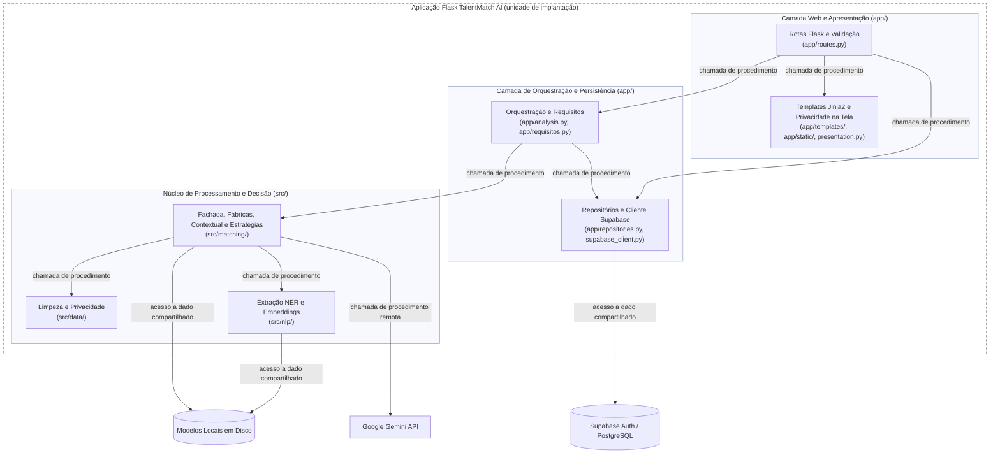
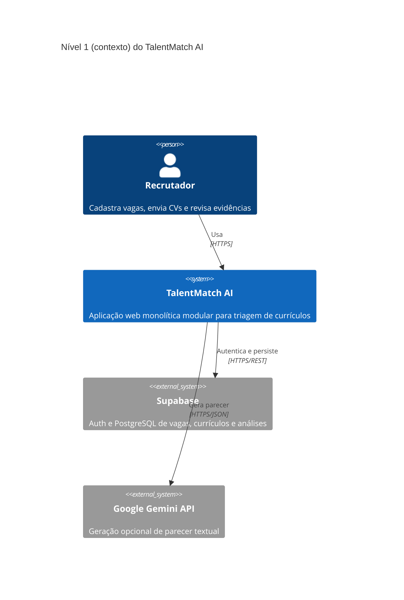
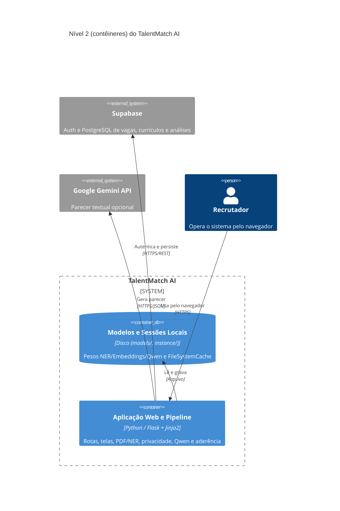
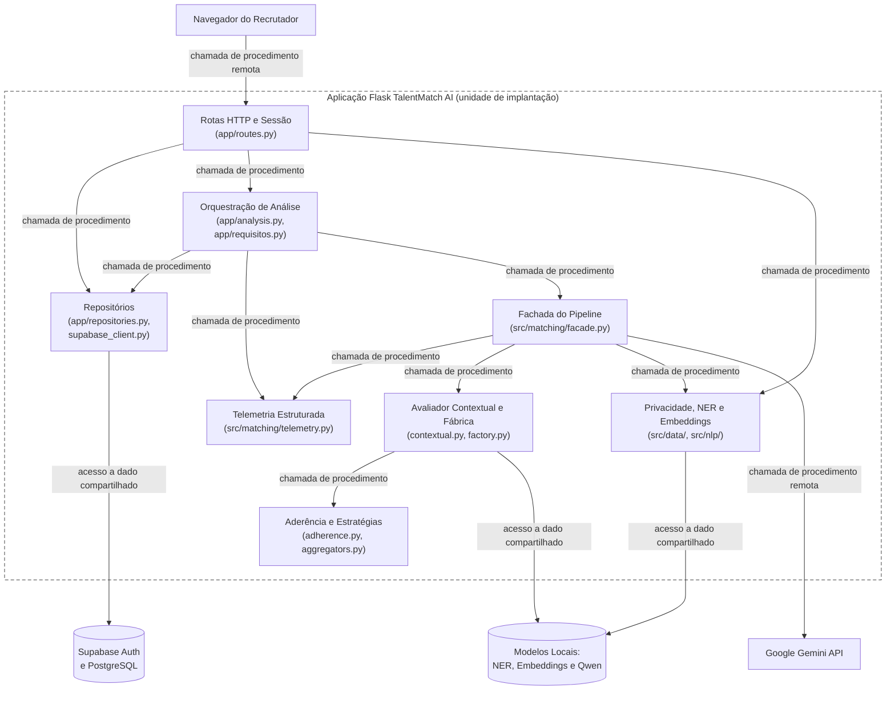
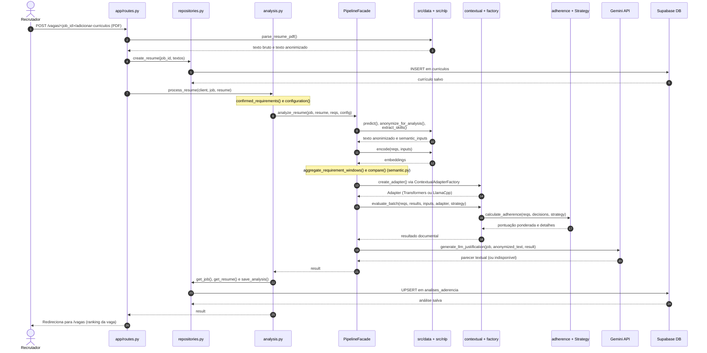

# 3. Arquitetura do Sistema — TalentMatch AI

Este documento descreve a arquitetura real do **TalentMatch AI** com base no vocabulário de componentes, conectores e configurações, no modelo C4 e nos critérios de estilo arquitetural de Abreu (2026).

---

## 3.1 Plano macro: Monólito modular em evolução gradual

O **TalentMatch AI** é uma aplicação web desenvolvida em Python/Flask implantada como uma **única unidade de implantação** (*deployment unit*), operando em processo único local (conforme [ADR-0001](../adrs/0001-estrutura-geral.md)).

No plano macro, a estrutura segue um **monólito em transição para monólito modular** (Capítulos 5 e 6 de Abreu, 2026): toda a aplicação web (`app/`) e o núcleo de processamento (`src/`) sobem no mesmo processo e compartilham a mesma camada de persistência externa (Supabase), mas o código está particionado por responsabilidades explícitas com pontos de entrada bem definidos ([ADR-0003](../adrs/0003-organizacao-interna.md)).

### Justificativa pelo livro (Capítulo 6 — Monolito modular)

- **Quando adotar:** o sistema é mantido por uma equipe pequena (5 integrantes) no mesmo repositório, com ciclo de entrega único e domínio de triagem documental ainda em consolidação. Conforme o Capítulo 6, manter uma única unidade de implantação evita migrações de dados entre serviços, contratos de rede e infraestrutura distribuída enquanto as fronteiras internas amadurecem.
- **Quando evitar (por que não distribuir agora):** não há múltiplos times independentes disputando janelas de entrega nem plataforma operacional de contêineres/mensageria em produção. Embora o processamento de IA (NER, embeddings e Qwen local) seja mais pesado que o cadastro de vagas, o volume atual ainda não justifica o custo de separar serviços em rede — caso a latência de upload se torne gargalo sob carga, a extração desse fluxo em tarefa assíncrona ou serviço dedicado já está prevista como evolução possível.
- **Custo real assumido:**
  - *Operação:* custo mínimo (um único processo Flask + dependências externas gerenciadas via HTTPS).
  - *Time e Governança:* exige revisão contínua nos Pull Requests para impedir acoplamento indevido entre rotas, persistência e núcleo de análise, pois o repositório ainda não utiliza uma ferramenta automatizada de fronteira (como `import-linter`) no pipeline.
  - *Desempenho e Isolamento:* todos os módulos compartilham o mesmo processo e memória; uma falha grave ou bloqueio longo de inferência afeta o processo inteiro (mitigado parcialmente por `MODEL_LOCK` e cache de modelos em `app/analysis.py`).

### Evidências no código (plano macro)

A aplicação sobe em um único servidor Flask com sessão local em arquivo ([app/__init__.py (L13-L31)](https://github.com/Makezuko/SI-PI6-2026-T101-G04/blob/bcd666570bfd9991b831b4f987cfff32f6d1aa53/app/__init__.py#L13-L31)), registra todas as rotas HTTP no mesmo processo ([app/__init__.py (L73-L76)](https://github.com/Makezuko/SI-PI6-2026-T101-G04/blob/bcd666570bfd9991b831b4f987cfff32f6d1aa53/app/__init__.py#L73-L76)) e compartilha em memória o lock reentrante ([app/analysis.py (L17-L18)](https://github.com/Makezuko/SI-PI6-2026-T101-G04/blob/bcd666570bfd9991b831b4f987cfff32f6d1aa53/app/analysis.py#L17-L18)) e o cache dos modelos NER e de embeddings ([app/analysis.py (L64-L77)](https://github.com/Makezuko/SI-PI6-2026-T101-G04/blob/bcd666570bfd9991b831b4f987cfff32f6d1aa53/app/analysis.py#L64-L77)):

```python
app = Flask(__name__)
secret = os.getenv('FLASK_SECRET_KEY')
if not secret or secret == 'secret-key':
    raise RuntimeError('Defina FLASK_SECRET_KEY no .env com uma chave aleatória.')

session_dir = Path(app.instance_path) / 'mvp_sessions'
session_dir.mkdir(parents=True, exist_ok=True)
app.config.update(
    SECRET_KEY=secret,
    SESSION_TYPE='cachelib',
    SESSION_CACHELIB=FileSystemCache(str(session_dir), threshold=500, mode=0o600),
    SESSION_PERMANENT=True,
    PERMANENT_SESSION_LIFETIME=timedelta(hours=8),
    SESSION_COOKIE_HTTPONLY=True,
    SESSION_COOKIE_SAMESITE='Lax',
    SESSION_COOKIE_SECURE=os.getenv('SESSION_COOKIE_SECURE', 'false').lower() == 'true',
    MAX_CONTENT_LENGTH=10 * 1024 * 1024,
)
Session(app)
```

Fonte: [app/__init__.py (L13-L31)](https://github.com/Makezuko/SI-PI6-2026-T101-G04/blob/bcd666570bfd9991b831b4f987cfff32f6d1aa53/app/__init__.py#L13-L31).

---

## 3.2 Plano interno e mapeamento de pastas

Internamente, o código combina organização em **camadas na borda web** (`app/`) com **módulos especializados por capacidade** no núcleo de processamento (`src/`), além de padrões GoF (`TalentMatchPipelineFacade`, `ContextualAdapterFactory` e `AdherenceScoreStrategy`) e uma camada explícita de persistência sobre o cliente Supabase (`app/repositories.py` e `app/supabase_client.py`).

Fonte do diagrama: [diagrams/organizacao-interna.mmd](../diagrams/organizacao-interna.mmd)



### Correspondência entre camadas/módulos e diretórios

| Parte da arquitetura | Pasta / Módulo real | Responsabilidade principal |
|---|---|---|
| Apresentação e borda HTTP | `app/templates/`, `app/static/`, `app/presentation.py`, `app/routes.py` | Renderização Jinja2, autenticação/sessão, validação de entrada e redirecionamento |
| Persistência | `app/repositories.py`, `app/supabase_client.py`, `sql/` | Consultas e gravação no Supabase (`vagas`, `curriculos`, `analises_aderencia`, `usuarios`) e adaptação de registros para os templates (`job_for_template`, `resume_for_template`) |
| Regras de requisitos e orquestração | `app/requisitos.py`, `app/analysis.py`, `app/auth_diagnostics.py` | Parsing/validação de requisitos, controle de cache/versões (`attach_analysis`, `dashboard_scores`) e disparo de `TalentMatchPipelineFacade` |
| Limpeza e privacidade | `src/data/` (`clean.py`, `privacy.py`, `load.py`, `validate.py`) | Extração de texto de PDF, detecção de spans pessoais e anonimização antes da análise semântica e da chamada ao Gemini |
| Extração NER e embeddings | `src/nlp/` (`inference.py`, `skills_extractor.py`, `embeddings.py`) | Inferência NER local, extração híbrida de competências e geração de vetores Sentence Transformer |
| Matching, IA contextual e GoF | `src/matching/` (`facade.py`, `factory.py`, `contextual.py`, `semantic.py`, `adherence.py`, `aggregators.py`, `llm_justification.py`, `telemetry.py`) | Fachada do pipeline, fábrica de runtimes locais (Transformers/llama.cpp), avaliação contextual Qwen, estratégias de aderência, parecer Gemini e telemetria estruturada |
| Verificação automatizada | `tests/` | Suítes `unittest` cobrindo rotas, privacidade, contratos SOLID, padrões GoF e aderência |

Nos *imports* reais da `main`, a transição modular ainda apresenta acoplamentos diretos da camada web com utilitários do núcleo: `app/routes.py` chama `parse_resume_pdf()` em `src/data/clean.py`, `app/presentation.py` utiliza `src/data/privacy.py` e `app/repositories.py` importa helpers de `src/data/` e `src/nlp/skills_extractor.py` para montar dados exibidos nos templates — ponto que reforça a consolidação gradual descrita nos ADRs 0001 e 0003.

### Evidências no código (fronteiras internas)

1. **Orquestração na camada de aplicação delegando para a fachada** — `app/analysis.py` não manipula diretamente NER, embeddings ou runtime Qwen; ele instancia `TalentMatchPipelineFacade` passando os loaders e o lock compartilhado ([app/analysis.py (L80-L98)](https://github.com/Makezuko/SI-PI6-2026-T101-G04/blob/bcd666570bfd9991b831b4f987cfff32f6d1aa53/app/analysis.py#L80-L98)):

```python
def analyze(job, resume):
    requirements = confirmed_requirements(job)
    config = configuration()
    facade = TalentMatchPipelineFacade(
        models_loader=load_models,
        contextual_loader=load_contextual_model,
        justification_generator=generate_llm_justification,
        lock=MODEL_LOCK,
    )
    try:
        result = facade.analyze_resume(
            job=job,
            resume=resume,
            requirements=requirements,
            config=config,
        )
    except PipelineExecutionError as exc:
        raise AnalysisError(str(exc)) from None
    return {**versions(job, resume, config), **{k: v for k, v in config.items() if k != 'contextual'}, 'result': result}
```

2. **Núcleo contextual, estratégia de aderência e chamada opcional ao Gemini na fachada** — `TalentMatchPipelineFacade` carrega o adaptador contextual sob `self._lock`, avalia os requisitos com a estratégia ativa ([src/matching/facade.py (L136-L156)](https://github.com/Makezuko/SI-PI6-2026-T101-G04/blob/bcd666570bfd9991b831b4f987cfff32f6d1aa53/src/matching/facade.py#L136-L156)) e gera a justificativa textual apenas sobre o texto anonimizado ([src/matching/facade.py (L171-L179)](https://github.com/Makezuko/SI-PI6-2026-T101-G04/blob/bcd666570bfd9991b831b4f987cfff32f6d1aa53/src/matching/facade.py#L171-L179)):

```python
with self._lock:
    ctx = config["contextual"]
    event("MODEL_LOAD_START")
    try:
        adapter = self._contextual_loader(
            ctx["model"],
            ctx["revision"],
            ctx["backend"],
            ctx["runtime"],
            ctx["runtime_revision"],
        )
        if adapter is None:
            raise ContextualTechnicalError("MODEL_LOAD_ERROR")
        event("MODEL_LOAD_OK")
        result = evaluate_batch(
            safe_requirements,
            results,
            inputs,
            adapter,
            strategy=active_strategy,
        )
```

```python
result["last_role"] = latest_role(raw, entities)
result["execution_id"] = execution_id.get()
result["llm_justification"] = self._justification_generator(
    job,
    anonymized_text=anonymized_text,
    candidate=resume,
    analysis_result=result,
)
return result
```

3. **Persistência isolada por requisição e gravação idempotente no Supabase** — `app/supabase_client.py` cria um cliente isolado por requisição reutilizando pool TLS por thread ([app/supabase_client.py (L22-L37)](https://github.com/Makezuko/SI-PI6-2026-T101-G04/blob/bcd666570bfd9991b831b4f987cfff32f6d1aa53/app/supabase_client.py#L22-L37)), e `app/repositories.py` executa `upsert` em `analises_aderencia` pela chave composta de hashes ([app/repositories.py (L364-L375)](https://github.com/Makezuko/SI-PI6-2026-T101-G04/blob/bcd666570bfd9991b831b4f987cfff32f6d1aa53/app/repositories.py#L364-L375)):

```python
def create_supabase_client():
    url = os.getenv('SUPABASE_URL')
    key = os.getenv('SUPABASE_KEY')
    if not url or not key:
        raise RuntimeError('Configure SUPABASE_URL e SUPABASE_KEY no .env.')
    if not key.startswith('sb_publishable_'):
        raise RuntimeError('Esta etapa usa uma chave sb_publishable_ do Supabase.')
    # Cada requisição cria seu cliente (sessões isoladas), reusando pool TLS da thread.
    return create_client(
        url, key,
        options=ClientOptions(
            persist_session=False,
            auto_refresh_token=False,
            httpx_client=_http_client(),
        ),
    )
```

```python
values = dict(payload, vaga_id=int(job_id), curriculo_id=int(resume_id),
              pontuacao_aderencia=score,
              # ISO UTC explícito: timestamptz conserva o instante;
              # timestamp conserva os campos UTC, sem guardar o offset.
              # Não reinterpretar datas legadas sem fuso na leitura.
              analisado_em=datetime.now(timezone.utc).isoformat())
response = client.table('analises_aderencia').upsert(
    values, on_conflict='vaga_id,curriculo_id,requirements_hash,text_hash,config_hash'
).execute()
if not response.data:
    raise RuntimeError('Não foi possível confirmar a persistência da análise.')
return response.data[0]
```

4. **Telemetria estruturada em processo (conector `chamada de procedimento` no C4 nível 3)** — `event()` emite JSON síncrono no logger `talentmatch.analysis` com `ContextVar`, sem fila ou broker externo ([src/matching/telemetry.py (L19-L22)](https://github.com/Makezuko/SI-PI6-2026-T101-G04/blob/bcd666570bfd9991b831b4f987cfff32f6d1aa53/src/matching/telemetry.py#L19-L22)):

```python
def event(name, **fields):
    if fields.keys() - ALLOWED:
        raise ValueError('Campo não permitido no rastreamento técnico')
    logger.info(json.dumps(dict(event=name, run_id=execution_id.get(), **fields), ensure_ascii=True))
```

---

## 3.3 Estilos considerados e descartados

### 1. Microsserviços (Capítulo 9)

A divisão em serviços independentes (por exemplo: serviço web, serviço de NLP/embeddings e serviço de avaliação contextual) permitiria escalar a inferência separadamente do servidor web. Entretanto, conforme os sinais de **"Quando evitar"** e **"Custo real"** do Capítulo 9, o estilo exige banco privado por serviço, automação de implantação contínua, rastreamento distribuído, tratamento de falhas parciais em rede e consistência eventual (sagas). Para uma equipe pequena sem plataforma dedicada e com domínio em consolidação, o custo operacional superaria o benefício.

### 2. Arquitetura orientada a eventos (Capítulo 11)

Adotar um corretor de mensagens (*message broker*) com publicação/consumo assíncrono desacoplaria o envio do currículo do processamento pesado. Porém, segundo o Capítulo 11 ("Quando evitar" e "Custo real"), o estilo introduz consistência eventual na interface, exige tratamento de duplicatas (idempotência), fila de mensagens mortas (*dead letter queue*) e operação contínua de um corretor externo, além de aumentar o esforço de depuração e testes ponta a ponta sem demanda atual de volume que o justifique.

---

## 3.4 Diagramas C4

Seguindo o Capítulo 3 e o Apêndice B.4 de Abreu (2026), os níveis 1 e 2 utilizam a notação C4 em Mermaid e o nível 3 utiliza diagrama de fluxo com conectores rotulados conforme a Tabela 3.1 do livro, mantendo o limite máximo de 12 elementos por figura.

### Nível 1 — Contexto

Fonte: [diagrams/c4-contexto.mmd](../diagrams/c4-contexto.mmd)



### Nível 2 — Contêineres

Fonte: [diagrams/c4-conteineres.mmd](../diagrams/c4-conteineres.mmd)



### Nível 3 — Componentes (contêiner Aplicação Web e Pipeline)

Fonte: [diagrams/c4-componentes.mmd](../diagrams/c4-componentes.mmd)



---

## 3.5 Diagrama de sequência — Fluxo central de análise de currículo

O diagrama abaixo acompanha o fluxo real executado em `POST /vagas/<job_id>/adicionar-curriculos` desde o recebimento do PDF até a persistência da análise e exibição do ranking.

Fonte: [diagrams/sequencia-analise-curriculo.mmd](../diagrams/sequencia-analise-curriculo.mmd)



### Evidências do fluxo no código

1. **Entrada HTTP, extração de PDF, persistência do currículo e disparo da análise** — na rota protegida `POST /vagas/<job_id>/adicionar-curriculos` ([app/routes.py (L451-L453)](https://github.com/Makezuko/SI-PI6-2026-T101-G04/blob/bcd666570bfd9991b831b4f987cfff32f6d1aa53/app/routes.py#L451-L453)), cada PDF passa por `parse_resume_pdf()`, `create_resume()` e `process_resume()` ([app/routes.py (L469-L493)](https://github.com/Makezuko/SI-PI6-2026-T101-G04/blob/bcd666570bfd9991b831b4f987cfff32f6d1aa53/app/routes.py#L469-L493)):

```python
for file_storage in valid_files:
    try:
        if not file_storage.filename.lower().endswith('.pdf'):
            raise AnalysisError('Envie arquivos no formato PDF.')
        parsed = parse_resume_pdf(file_storage, filename=file_storage.filename)
        resume = create_resume(g.supabase, job['id'], parsed['filename'], parsed['raw_text'], parsed['anonymized_text'])
        targets[resume['id']] = resume
    except AnalysisError as error:
        flash(str(error), 'error')
    except Exception as error:
        app.logger.warning('Falha no upload: %s', type(error).__name__)
        flash('Não foi possível extrair ou salvar um arquivo. Confira o cadastro antes de reenviar.', 'error')
for resume in targets.values():
    try:
        result = process_resume(g.supabase, job, resume)
        flash(f"Currículo {resume['id']}: análise salva. Execução {execution_id.get()}." if result['score'] is not None else
              f"Currículo {resume['id']}: análise incompleta salva; sem índice.", 'success')
    except AnalysisError as error:
        flash(f"Currículo {resume['id']}: {error}", 'error')
    except Exception as error:
        from src.matching.telemetry import failure
        failure(error, 'processing')
        flash(f"Falha tecnica no processamento do curriculo {resume['id']} [{type(error).__name__}]. Execucao {execution_id.get()}. Nenhuma nova analise foi salva. Consulte ANALYSIS_STAGE_ERROR no terminal.", 'error')

return redirect(url_for('vagas', job_id=job['id']))
```

2. **Validação de concorrência/versão e gravação da análise** — após `analyze()`, `process_resume()` reconsulta vaga e currículo antes de chamar `save_analysis()`, evitando salvar resultado obsoleto ([app/analysis.py (L257-L276)](https://github.com/Makezuko/SI-PI6-2026-T101-G04/blob/bcd666570bfd9991b831b4f987cfff32f6d1aa53/app/analysis.py#L257-L276)):

```python
def process_resume(client, job, resume):
    from app.repositories import save_analysis, get_resume
    event('ANALYSIS_EFFECTIVE_CONFIG', **process_configuration())
    payload = analyze(job, resume)
    # Evita publicar como atual uma análise cujo texto/requisitos mudaram durante o cálculo.
    from app.repositories import get_job
    latest_job = get_job(client, job['id'])
    latest_resume = get_resume(client, job['id'], resume['id'])
    if (not latest_job or not latest_resume
            or any(payload.get(key) != value for key, value in versions(latest_job, latest_resume).items())):
        raise AnalysisError('Vaga ou currículo mudou durante a análise. Reenvie para recalcular.')
    event('ANALYSIS_SAVE_START')
    try:
        record = save_analysis(client, job['id'], resume['id'], payload)
    except Exception:
        event('ANALYSIS_SAVE_ERROR', error_code='PERSISTENCE_ERROR')
        raise
    event('ANALYSIS_SAVED', analysis_id=record.get('id'), persisted_run_id=payload['result']['execution_id'])
    # A decisão manual em curriculos.status nunca é alterada por processamento.
    return payload['result']
```

---

## 3.6 Diagramas de classes dos padrões GoF

Os arquivos-fonte dos diagramas de classes dos três padrões aplicados no núcleo (`Strategy`, `Factory Method` e `Facade`) estão versionados na pasta `diagrams/`. Eles mostram apenas classes e protocolos que existem no código; funções de módulo (como `calculate_adherence()` e `analyze()`) aparecem como notas. Os diagramas embutidos em [docs/6-gof.md](6-gof.md) ainda estão na versão anterior e serão sincronizados com estes arquivos em PR separado da frente de padrões GoF:

- [diagrams/gof-strategy.mmd](../diagrams/gof-strategy.mmd) — contrato e estratégias concretas em [src/matching/aggregators.py (L8-L35)](https://github.com/Makezuko/SI-PI6-2026-T101-G04/blob/bcd666570bfd9991b831b4f987cfff32f6d1aa53/src/matching/aggregators.py#L8-L35)
- [diagrams/gof-factory-method.mmd](../diagrams/gof-factory-method.mmd) — fábrica abstrata e criadores concretos em [src/matching/factory.py (L11-L49)](https://github.com/Makezuko/SI-PI6-2026-T101-G04/blob/bcd666570bfd9991b831b4f987cfff32f6d1aa53/src/matching/factory.py#L11-L49)
- [diagrams/gof-facade.mmd](../diagrams/gof-facade.mmd) — fachada do pipeline em [src/matching/facade.py (L28-L53)](https://github.com/Makezuko/SI-PI6-2026-T101-G04/blob/bcd666570bfd9991b831b4f987cfff32f6d1aa53/src/matching/facade.py#L28-L53)
