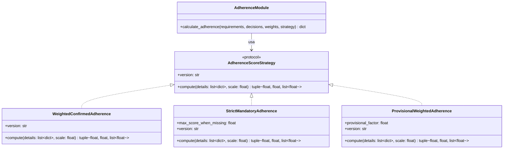
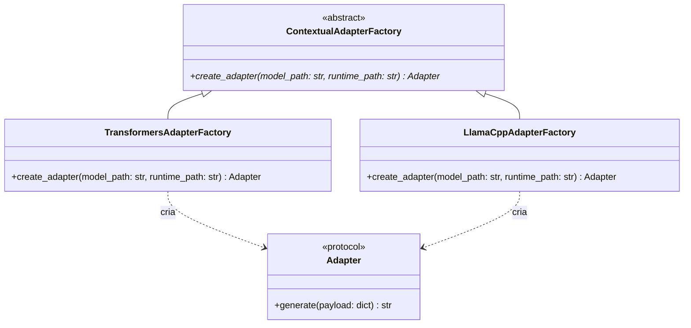
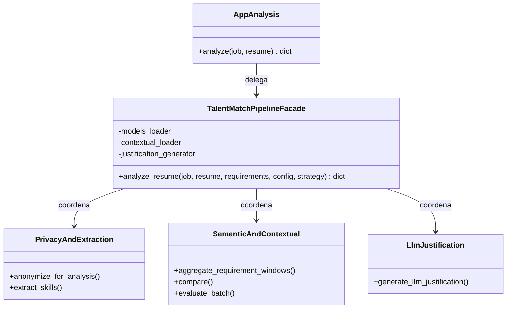

# 6. Padrões de Projeto GoF

Este documento apresenta os três padrões de projeto do catálogo [Refactoring Guru](https://refactoring.guru/pt-br/design-patterns) aplicados a problemas reais do fluxo contextual atual de análise e aderência do **TalentMatch AI** (`src/matching/` e `app/analysis.py`).

---

## 6.1 Strategy (Comportamental)

- **Nome e categoria:** *Strategy* — Padrão Comportamental.
- **Problema concreto:** Em [src/matching/adherence.py](../src/matching/adherence.py), `calculate_adherence()` aplicava uma fórmula fixa de pontuação documental (`FORMULA_VERSION = "3.1-experimental"`). Variar a política de cálculo — por exemplo, limitar a pontuação quando um requisito obrigatório tem estado `nao_identificado` ou atribuir peso parcial provisório a itens em `revisao_necessaria` — exigiria editar diretamente a função central com condicionais (`if/elif`), aumentando o risco de regressão.
- **Solução aplicada:** A lógica de pontuação foi extraída para o contrato `AdherenceScoreStrategy` em [src/matching/aggregators.py](../src/matching/aggregators.py), com três estratégias intercambiáveis (`WeightedConfirmedAdherence`, `StrictMandatoryAdherence` e `ProvisionalWeightedAdherence`), recebidas pelo parâmetro opcional `strategy` em `calculate_adherence()` e encaminhadas também por `evaluate_batch()` em [src/matching/contextual.py](../src/matching/contextual.py).

```python
# src/matching/aggregators.py
@runtime_checkable
class AdherenceScoreStrategy(Protocol):
    @property
    def version(self) -> str: ...

    def compute(
        self, details: list[dict], scale: float
    ) -> tuple[float, float, list[float]]: ...
```

```python
# src/matching/adherence.py
def calculate_adherence(requirements, decisions, weights=None, strategy=None):
    active_strategy = WeightedConfirmedAdherence() if strategy is None else strategy
    if not isinstance(active_strategy, AdherenceScoreStrategy):
        raise TypeError('strategy deve implementar o protocolo AdherenceScoreStrategy.')
    ...
    score, maximum_score, contributions = active_strategy.compute(details, scale)
```

> *Links permanentes (substituir `<COMMIT_HASH>` após o merge na `main`):*
> - `https://github.com/Makezuko/SI-PI6-2026-T101-G04/blob/<COMMIT_HASH>/src/matching/aggregators.py#L8-L35`
> - `https://github.com/Makezuko/SI-PI6-2026-T101-G04/blob/<COMMIT_HASH>/src/matching/adherence.py#L13-L64`

### Diagrama de classes (Mermaid)



- **Benefício:** Novas políticas de aderência entram como classes isoladas sem alterar `calculate_adherence()`, preservando o contrato padrão `3.1-experimental` e os testes de regressão.
- **Custo:** Aumenta o número de classes no pacote `src/matching/` e acrescenta um nível de indireção ao localizar a regra de cálculo.

---

## 6.2 Factory Method (Criacional)

- **Nome e categoria:** *Factory Method* — Padrão Criacional.
- **Problema concreto:** Em [src/matching/contextual.py](../src/matching/contextual.py), a função `create_adapter()` escolhia e instanciava diretamente os backends do avaliador contextual (`LocalTransformersAdapter` ou `LlamaCppAdapter`) por meio de condicionais `if/elif`. A inclusão de um novo runtime local exigia modificar `contextual.py` e acoplava o módulo às implementações concretas de inferência.
- **Solução aplicada:** Em [src/matching/factory.py](../src/matching/factory.py), foi criada a classe abstrata `ContextualAdapterFactory` com o método fábrica `create_adapter(model_path, runtime_path)`, implementado pelas fábricas concretas `TransformersAdapterFactory` e `LlamaCppAdapterFactory`, além do seletor `get_contextual_adapter_factory(backend)`. A função `create_adapter()` em [src/matching/contextual.py](../src/matching/contextual.py) passou a delegar para essa fábrica.

```python
# src/matching/factory.py
class ContextualAdapterFactory(ABC):
    """Criador abstrato que define o Factory Method ``create_adapter``."""

    @abstractmethod
    def create_adapter(self, model_path: str, runtime_path: str = "") -> Adapter:
        raise NotImplementedError
```

```python
# src/matching/contextual.py
def create_adapter(path=None):
    config = settings()
    from src.matching.factory import get_contextual_adapter_factory

    factory = get_contextual_adapter_factory(config['backend'])
    return factory.create_adapter(path or config['model'], config['runtime'])
```

> *Links permanentes (substituir `<COMMIT_HASH>` após o merge na `main`):*
> - `https://github.com/Makezuko/SI-PI6-2026-T101-G04/blob/<COMMIT_HASH>/src/matching/factory.py#L11-L49`
> - `https://github.com/Makezuko/SI-PI6-2026-T101-G04/blob/<COMMIT_HASH>/src/matching/contextual.py#L88-L93`

### Diagrama de classes (Mermaid)



- **Benefício:** Desacopla `contextual.py` da instanciação concreta dos runtimes (`transformers` e `llama_cpp`) e facilita a adição de novos backends sem alterar o fluxo principal.
- **Custo:** Introduz um módulo adicional (`src/matching/factory.py`) e uma hierarquia extra para criação dos adaptadores.

---

## 6.3 Facade (Estrutural)

- **Nome e categoria:** *Facade* — Padrão Estrutural.
- **Problema concreto:** Em [app/analysis.py](../app/analysis.py), `analyze()` orquestrava diretamente múltiplos subsistemas internos em sequência: verificação do avaliador contextual ativo, extração NER (`load_models`, `ResumeNERPredictor`), detecção e anonimização de dados pessoais (`src/data/privacy.py`, `src/data/clean.py`, `unsafe`), extração e sanitização de skills (`extract_skills`), janelas e embeddings (`ResumeEmbedder`, `aggregate_requirement_windows`, `compare`), avaliador contextual Qwen (`load_contextual_model`, `evaluate_batch`), telemetria (`stage`, `event`) e justificativa via Gemini (`generate_llm_justification`).
- **Solução aplicada:** Toda essa coordenação foi encapsulada em `TalentMatchPipelineFacade` ([src/matching/facade.py](../src/matching/facade.py)), por trás do método `analyze_resume(job, resume, requirements, config, strategy=None)`. Em [app/analysis.py](../app/analysis.py), `analyze()` passou a instanciar e acionar a fachada preservando locks, telemetria e pontos de injeção para testes.

```python
# src/matching/facade.py
class TalentMatchPipelineFacade:
    """Unifica extração NER, anonimização, embeddings, avaliador contextual e justificativa."""

    def analyze_resume(
        self,
        job: dict,
        resume: dict,
        requirements: list[dict],
        config: dict,
        strategy: AdherenceScoreStrategy | None = None,
    ) -> dict:
        ...
```

```python
# app/analysis.py
def analyze(job, resume):
    requirements = confirmed_requirements(job)
    config = configuration()
    facade = TalentMatchPipelineFacade(
        models_loader=load_models,
        contextual_loader=load_contextual_model,
        justification_generator=generate_llm_justification,
        lock=MODEL_LOCK,
    )
    try:
        result = facade.analyze_resume(
            job=job, resume=resume, requirements=requirements, config=config,
        )
    except PipelineExecutionError as exc:
        raise AnalysisError(str(exc)) from None
    return {**versions(job, resume, config), **{k: v for k, v in config.items() if k != 'contextual'}, 'result': result}
```

> *Links permanentes (substituir `<COMMIT_HASH>` após o merge na `main`):*
> - `https://github.com/Makezuko/SI-PI6-2026-T101-G04/blob/<COMMIT_HASH>/src/matching/facade.py#L28-L179`
> - `https://github.com/Makezuko/SI-PI6-2026-T101-G04/blob/<COMMIT_HASH>/app/analysis.py#L80-L98`

### Diagrama de classes (Mermaid)



- **Benefício:** Reduziu o acoplamento direto de `app/analysis.py` aos subsistemas de NLP, privacidade, Qwen e Gemini, centralizando a execução do pipeline em um ponto único reutilizável e testável.
- **Custo:** Concentra a coordenação dos estágios em `TalentMatchPipelineFacade`, exigindo disciplina para não incorporar regras de negócio específicas dentro da fachada.

---

## 6.4 Validação Automatizada

As refatorações dos três padrões são validadas pelas suítes em [tests/test_gof_patterns.py](../tests/test_gof_patterns.py), [tests/test_solid_matching.py](../tests/test_solid_matching.py), [tests/test_adherence.py](../tests/test_adherence.py), [tests/test_contextual.py](../tests/test_contextual.py) e [tests/test_llm_justification.py](../tests/test_llm_justification.py):

```powershell
python -m unittest discover -s tests -p "test_gof_patterns.py"
python -m unittest discover -s tests -p "test_solid_matching.py"
python -m unittest discover -s tests -p "test_adherence.py"
python -m unittest discover -s tests -p "test_contextual.py"
python -m unittest discover -s tests -p "test_llm_justification.py"
```
